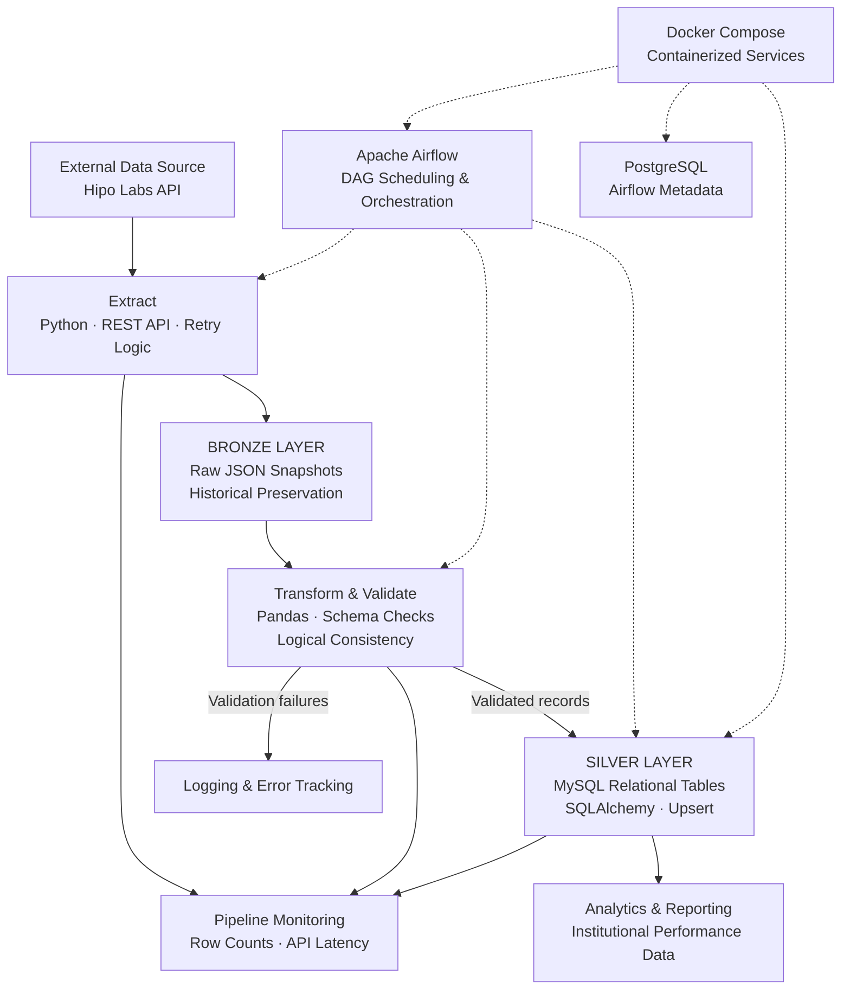

## Data Integration Pipeline : Python · Docker · Apache Airflow · MySQL · Data Quality

An automated, containerized data pipeline that transforms fragmented institutional data into structured, validated, and reusable datasets.

Designed around a Canadian higher-education use case, this project demonstrates how API ingestion, data-quality enforcement, historical snapshots, and relational persistence can work together to support reliable institutional reporting and longitudinal analysis.

## Architecture Overview

The pipeline separates data ingestion, validation, persistence, and orchestration so that each stage has a defined responsibility.

## Engineering Approach

### 1. Automated Ingestion

- Connects to the Hipo Labs API to retrieve nested JSON data.
- Handles network instability through retry logic and exponential backoff.
- Separates extraction from downstream transformation to make the workflow easier to maintain.

### 2. Data Quality & Validation

Data quality is enforced before records reach the final relational tables.

- Schema and structural validation.
- Logical consistency checks, including required institutional attributes.
- Rejection of records that do not satisfy validation rules.
- Centralized logging of transformation errors and processing results.

### 3. Medallion Data Architecture

**Bronze — Raw Data Preservation**

- Stores raw JSON snapshots.
- Preserves source-level information for traceability and historical reference.
- Supports subsequent reprocessing without requiring another API extraction.

**Silver — Validated Relational Data**

- Transforms nested API responses into structured relational tables.
- Uses MySQL for persistent storage.
- Implements SQLAlchemy-based upsert logic to avoid duplicate records during repeated ingestion.

### 4. Orchestration & Containerization

Apache Airflow coordinates the workflow through a scheduled DAG.

- `university_etl` defines the extraction, transformation, and loading sequence.
- LocalExecutor manages task execution.
- Docker Compose coordinates the application and supporting services.
- PostgreSQL stores Airflow metadata, while MySQL holds the institutional data.

## Pipeline Components

| Component | Responsibility |
|---|---|
| Python | API extraction and data transformation |
| Pandas | Structured data processing |
| SQLAlchemy | Database interaction and upsert operations |
| MySQL | Persistent institutional data |
| Apache Airflow | Scheduling and workflow orchestration |
| PostgreSQL | Airflow metadata storage |
| Docker & Docker Compose | Reproducible service environment |

## Why This Architecture Matters

Institutional analytics depends on more than the availability of dashboards or analytical models. It depends on the reliability and consistency of the data feeding them.

This architecture addresses several common challenges:

- **Fragmented sources:** consolidates external institutional data into structured relational datasets.
- **Manual data handling:** automates recurring ingestion and transformation tasks.
- **Data quality risks:** applies validation before persistence.
- **Limited historical traceability:** retains raw snapshots in the Bronze layer.
- **Operational reliability:** uses orchestration, logging, and containerized services to make execution repeatable.

The resulting dataset provides a structured foundation for institutional reporting, performance monitoring, and longitudinal analysis.

## Technology Stack

- **Languages:** Python 3.11, SQL
- **Data Processing:** Pandas
- **Database:** MySQL, PostgreSQL
- **Orchestration:** Apache Airflow
- **Containerization:** Docker, Docker Compose
- **Database Integration:** SQLAlchemy
- **Data Architecture:** Medallion (Bronze & Silver)

## Deployment

The project runs as a containerized local environment using Docker Compose.

The Airflow web interface is available at:

`http://localhost:8080`

The `university_etl` DAG is configured for daily execution and can also be triggered manually.

Refer to the Docker Compose configuration and project source files for service setup and execution details.

---

**Engineering principle**

Reliable institutional intelligence begins with reliable data.

Automation makes the process repeatable. Validation makes the data trustworthy. Architecture makes it reusable for decision-making.